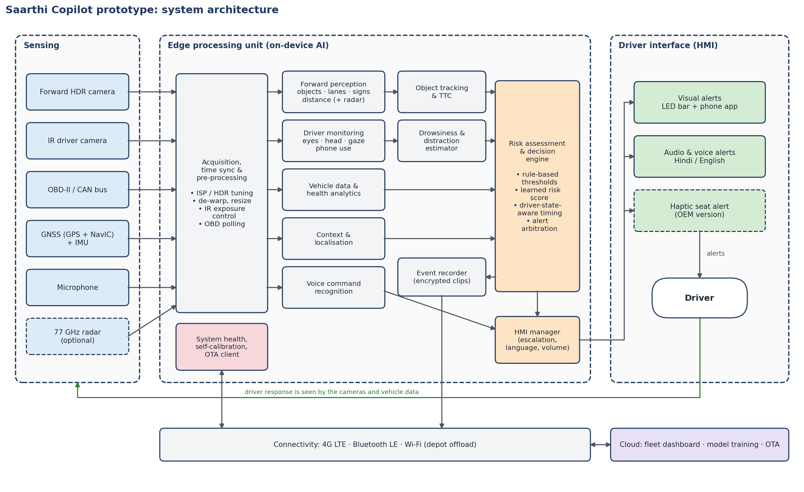
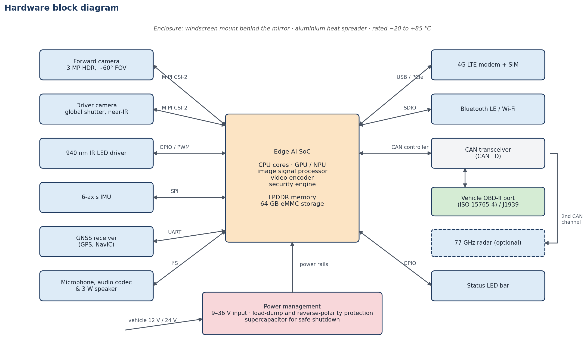
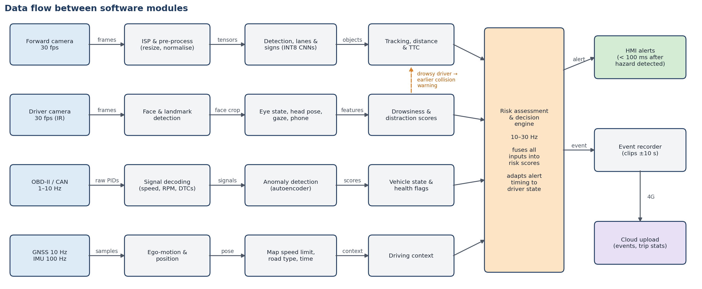
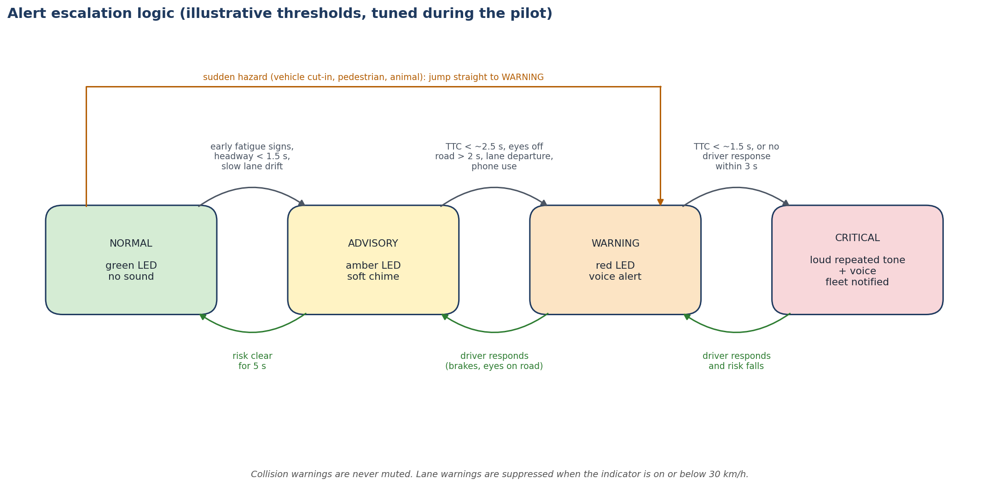

# Conceptual Design of an AI-Powered Driver Assistance System Prototype

**Week 3 task, Automotive AI Innovation Internship (YuvaIntern)**

The conceptual design of **Saarthi Copilot v1**, a prototype AI driver assistance system for Indian roads. It turns the [Week 1 roadmap](https://github.com/himshxrmx/automotive-ai-strategic-roadmap) into a buildable design and applies the findings of the [Week 2 sensor fusion study](https://github.com/himshxrmx/sensor-fusion-feasibility-study).

📄 **Full report:** [Week3_ADAS_Prototype_Conceptual_Design.docx](Week3_ADAS_Prototype_Conceptual_Design.docx)

## What it does

| Feature | Detects |
|---|---|
| Drowsiness warning | Long or frequent eye closures, yawning, head nods, lane weaving |
| Distraction warning | Eyes off the road for more than 2 s, phone use |
| Forward collision warning | Low time-to-collision with vehicles, two-wheelers, pedestrians and animals |
| Headway warning | Following too closely |
| Lane / road-edge departure | Unintended drift, including on unmarked roads |
| Overspeed warning | Speed above the recognised or mapped limit |
| Vehicle health alerts | Abnormal OBD-II data and fault codes |

It is **warning-only** (SAE Level 0): it never brakes or steers in v1.

## System architecture



## Hardware

Forward 3 MP HDR camera · near-IR global-shutter driver camera with 940 nm LEDs · edge AI SoC · read-only OBD-II / J1939 interface · GNSS (GPS + NavIC) and IMU · 4G LTE · optional 77 GHz radar for fleets.



## Software and data flow

Eleven modules (M1–M11) on embedded Linux, running INT8 neural networks on the device. The hazard-to-alert path is budgeted at **90 ms**.



## AI algorithms

| Function | Approach |
|---|---|
| Object detection | One-stage CNN (YOLO family), INT8 |
| Distance | Ground-plane geometry + class size priors (radar when fitted) |
| Lanes and road edges | Row-anchor lane network + drivable-area segmentation |
| Tracking and collision risk | Kalman filter + Hungarian matching; TTC and headway |
| Driver monitoring | Face landmarks → EAR, PERCLOS, head pose, gaze, phone detection → temporal drowsiness classifier |
| Vehicle health | Autoencoder + Isolation Forest anomaly detection |
| Decisions | Rule-based state machine + learned risk score, with collision warnings given earlier when the driver is drowsy |

## Driver alerts



## Report contents

Requirements · research on existing ADAS · system overview · hardware design · software design · AI algorithm justification · HMI design · end-to-end workflow · safety, security and privacy · design trade-offs · limitations · future scalability · build and validation plan · bill of materials · requirements traceability.

## Repository contents

```
.
├── README.md
├── Week3_ADAS_Prototype_Conceptual_Design.docx   # the full report
└── images/
    ├── fig1_system_architecture.png
    ├── fig2_hardware_block_diagram.png
    ├── fig3_data_flow.png
    └── fig4_alert_escalation.png
```
