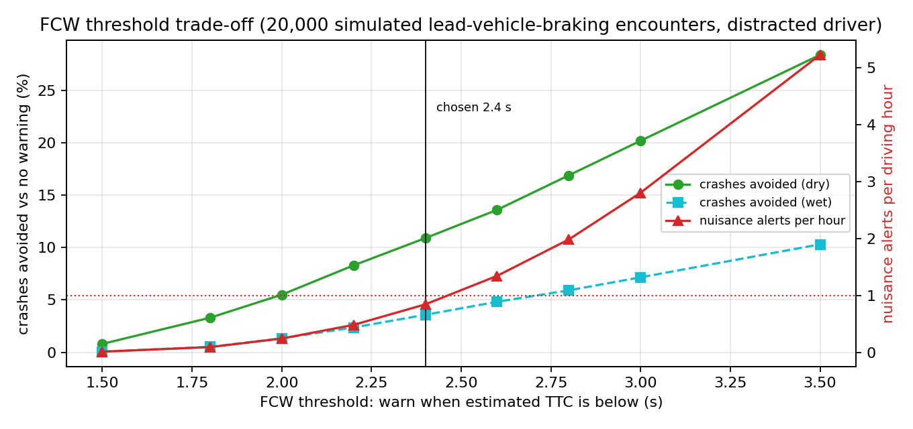
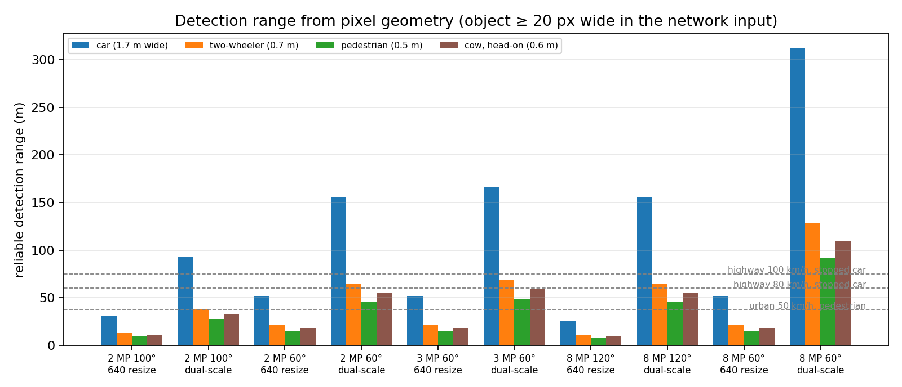

# Conceptual Design of an AI-Powered Driver Assistance System Prototype

**Week 3 task, Automotive AI Innovation Internship (YuvaIntern)**

The conceptual design of **Saarthi Copilot v1**, a windscreen-mounted, warning-only AI driver assistance system for Indian roads. It turns the [Week 1 roadmap](https://github.com/himshxrmx/automotive-ai-strategic-roadmap) into a buildable design and applies the [Week 2 sensor fusion study](https://github.com/himshxrmx/sensor-fusion-feasibility-study). Every key design number is **derived from an analysis in this repository**, not assumed.

📄 **Full design document:** [Week3_ADAS_Prototype_Conceptual_Design.docx](Week3_ADAS_Prototype_Conceptual_Design.docx)

## Architecture


Forward HDR camera + infrared driver camera + edge AI SoC + read-only OBD-II, optional 77 GHz radar for fleets. Eleven software modules; warnings for drowsiness, distraction, forward collision, headway, lane departure, overspeed and vehicle faults.

## The analyses behind the design

| Decision | Analysis | Result |
|---|---|---|
| **Camera and detector** | Pixel geometry: object must be ≥ 20 px wide in the network input | A 640-px resize sees a car only to **52 m**; a dual-scale detector (640 full frame + 1280 px native centre crop) on a 3 MP 60° camera reaches **166 m** (car), **68 m** (two-wheeler), **49 m** (pedestrian) vs **75 m** needed at 100 km/h |
| **Collision-warning threshold** | Monte Carlo of **20,000** lead-vehicle-braking encounters with a distracted driver + nuisance-alert model | Warning at **TTC 2.4 s**: severe crashes **39.5% → 27.0%**, mean impact **36.8 → 31.8 km/h**, **0.85** nuisance alerts/h (limit 1) |
| **Drowsiness thresholds** | Simulated 30 fps eye signals: 60 h alert driving, 120 drowsy segments, classifier errors, dashboard glances | Dashboard glances caused **14.8** false microsleep alarms/h; **head-pose gating** cuts this to **1.7**. PERCLOS > 12% (60 s) detects **90%** of drowsy drivers at **0.18** false alarms/h |
| **Processor** | Compute budget from model sizes (YOLOv8-class detectors, lane, DMS networks) | **1,375 GOPS** needed = **57%** of an 8 TOPS SoC at 30% utilisation |
| **Thermal design** | Power budget × thermal resistance | **8.5 W** typical; case **76 °C** in a 50 °C cabin → deferred uploads and reduced start mode |
| **Risk** | FMEA of 12 failure modes (S × O × D) | Top risks: driver over-reliance, sunglasses blocking DMS, two-wheelers at night |




## Repository

```
src/design_analysis.py   camera geometry, FCW Monte Carlo, drowsiness simulation, compute and power budgets
src/build_report.py      builds the Word document from the results
src/doclib.py            small python-docx helper
content/base_text.json   reusable text sections of the document
results/                 camera_ranges.csv, fcw_threshold.csv, drowsiness_detection.csv, design_analysis.json
figures/ images/         charts and architecture diagrams
```

## Reproduce

```bash
pip install numpy pandas matplotlib python-docx
python src/design_analysis.py    # about 2 minutes
python src/build_report.py
```

Human-behaviour and sensor parameters are typical published ranges (listed in the code and the document); the pilot will replace them with Indian measurements.

---
Him Sharma · Automotive AI Innovation Internship (YuvaIntern) · November 2026
